Ильичев Тимофей Алексеевич БИВТ 26-6-3

## Лабораторная работа 6 — CLI и argparse

Две программы принимают команды и параметры из терминала. [cli_text.py](src/lab06/cli_text.py)
выводит файлы и считает слова, [cli_convert.py](src/lab06/cli_convert.py) запускает конвертеры ЛР5.
Для статистики использую функции ЛР3 из [text.py](src/lib/text.py): normalize, tokenize,
count_freq и top_n. Алгоритмы конвертации JSON/CSV повторно не пишу.

| Программа | Подкоманда | Параметры | Результат |
|---|---|---|---|
| cli_text | cat | `--input`, необязательный `-n` | Содержимое файла, с `-n` — номера строк |
| cli_text | stats | `--input`, необязательный `--top 5` | Всего слов, уникальные слова, топ-N |
| cli_convert | json2csv | `--in`, `--out` | JSON → CSV |
| cli_convert | csv2json | `--in`, `--out` | CSV → JSON |
| cli_convert | csv2xlsx | `--in`, `--out` | CSV → XLSX |

Запуск из корня проекта, Python 3.10+. На Windows использую `py -m`,
на Linux/macOS обычно `python3 -m`. Подкоманда пишется перед её параметрами.
Пути с пробелами нужно заключать в кавычки. Все входные файлы читаются в UTF-8.

Подкоманды созданы через `add_subparsers(dest="command", required=True)`.
После `parse_args()` выбранная команда лежит в `args.command`, а параметры —
в `args.input`, `args.top`, `args.n` или `args.output`. Дальше `if/elif` вызывает нужную функцию.
`--input`, `--in` и `--out` обязательны. Флаг `-n` использует `action="store_true"`:
без флага False, с флагом True. Для `--top` задан `type=int`, значение по умолчанию 5,
ноль и отрицательные числа запрещены.

### Сценарий 1 — вывод файлов и статистика

Входной [stats.txt](data/lab06/samples/stats.txt):

```text
Python читает текст. Python считает слова.
Текст хранится в файле. Слова повторяются: текст, слова, Python.
```

```powershell
py -m src.lab06.cli_text cat --input data/lab06/samples/stats.txt
py -m src.lab06.cli_text cat --input data/lab05/samples/people.csv -n
```

Вывод второй команды:

```text
1: name,age,city
2: Alice,22,SPB
3: Bob,25,Moscow
4: Carlos,30,Kazan
5: Dana,21,SPB
6: Andrey,27,Novosibirsk
```

`run_cat(path: str, numbered: bool) -> None` читает файл функцией `read_text` из ЛР4.
`splitlines()` разбивает текст на строки и убирает переводы строк,
`enumerate(lines, start=1)` даёт номер. Обычный `print` добавляет один перевод строки.
`run_stats(path: str, top: int) -> None` печатает статистику.
Обе функции принимают те же параметры и возвращают None, как в примере Артемия.

```powershell
py -m src.lab06.cli_text stats --input data/lab06/samples/stats.txt --top 5
```

```text
Всего слов: 15
Уникальных слов: 9
Топ-5:
python:3
слова:3
текст:3
в:1
повторяются:1
```

Сначала нормализую текст и получаю список слов, потом считаю частоты.
Регистр и пунктуация не разделяют одинаковые слова. Топ отсортирован по убыванию
частоты, при равенстве — по слову. `--top 2` выведет только `python:3` и `слова:3`.
Если уникальных слов меньше N, выводятся все имеющиеся.

Для [empty.txt](data/lab06/samples/empty.txt) команда `cat` ничего не выводит,
а `stats` печатает нулевые счётчики и заголовок топа без слов.

### Сценарий 2 — конвертации

Использую исходные данные ЛР5 из [data/lab05/samples](data/lab05/samples).
Результаты сохраняю в [data/out](data/out), как требует условие ЛР6.

```powershell
py -m src.lab06.cli_convert json2csv --in data/lab05/samples/people.json --out data/out/people.csv
py -m src.lab06.cli_convert csv2json --in data/lab05/samples/people.csv --out data/out/people.json
py -m src.lab06.cli_convert csv2xlsx --in data/lab05/samples/people.csv --out data/out/people.xlsx
```

```text
Готово: data/lab05/samples/people.json -> data/out/people.csv
Готово: data/lab05/samples/people.csv -> data/out/people.json
Готово: data/lab05/samples/people.csv -> data/out/people.xlsx
```

В [people.csv](data/out/people.csv) заголовок `name,age,city` и 5 записей.
В [people.json](data/out/people.json) — 5 объектов с теми же ключами;
возраст после чтения CSV остаётся строкой, например `"age": "22"`.
В [people.xlsx](data/out/people.xlsx) один лист `Sheet1`, 6 строк с заголовком,
3 столбца с ширинами 8, 8 и 13. Значения записаны как текст, строки с `=` не становятся формулами.

Недостающие выходные каталоги создаются автоматически. Существующий результат
перезаписывается. Для каждой конвертации проверяются расширения обоих путей.

Конвертеры вызываются с двумя путями и возвращают None, как в примере Артемия.
Использую прежние функции ЛР5 без дополнительных режимов.
Для XLSX нужна библиотека openpyxl из [requirements.txt](requirements.txt):

```powershell
py -m pip install -r requirements.txt
```

Сама CLI-оболочка использует стандартные модули, но конвертер XLSX зависит от openpyxl.
Это сохраняет подход ЛР5 и примера Артемия; буквальное ограничение задания
«без внешних библиотек» для XLSX в текущем варианте не выполнено.

### Сценарий 3 — справка

Справку создаёт argparse: общий `--help` показывает подкоманды,
а `подкоманда --help` — параметры выбранной операции.

```powershell
py -m src.lab06.cli_text --help
py -m src.lab06.cli_text cat --help
py -m src.lab06.cli_text stats --help
py -m src.lab06.cli_convert --help
py -m src.lab06.cli_convert json2csv --help
py -m src.lab06.cli_convert csv2json --help
py -m src.lab06.cli_convert csv2xlsx --help
```

Например, справка `stats` содержит:

```text
--input INPUT  Путь к UTF-8 файлу
--top TOP      Количество слов в топе (по умолчанию 5)
```

### Сценарий 4 — ошибки

```powershell
py -m src.lab06.cli_text cat --input missing.txt
py -m src.lab06.cli_text stats --input data/lab06/samples/stats.txt --top abc
py -m src.lab06.cli_text stats --input data/lab06/samples/stats.txt --top -1
py -m src.lab06.cli_convert json2csv --in data/lab05/samples/people.json
```

Основная часть соответствующих сообщений (префикс зависит от версии Python):

```text
error: Файл не найден: missing.txt
error: argument --top: invalid int value: 'abc'
error: --top должен быть положительным числом
error: the following arguments are required: --out
```

Открытие отсутствующего файла вызывает `FileNotFoundError`, который оболочка
перехватывает и передаёт в `parser.error()`. Неподходящая кодировка вызывает
`UnicodeDecodeError`, неверная структура или расширение — `ValueError`.
Как в примере Артемия, в текстовой программе перехватываются FileNotFoundError
и UnicodeDecodeError, в конвертере — FileNotFoundError и ValueError.
Общего обработчика OSError нет. Перехваченные ошибки выводятся без traceback,
через stderr; `parser.error()` печатает справку по использованию и завершает программу с кодом 2.
Успешная команда и `--help` завершаются с кодом 0.

### Скриншоты

Скриншоты обязательны по условию. После запусков нужно сохранить реальные снимки
терминала в [images/lab06](images/lab06). Какие команды показать и как назвать снимки —
в [инструкции по скриншотам](images/lab06/README.md). Пока снимки не сделаны,
в отчёте приведены проверенные текстовые результаты, а не изображения.

### Проверка реализации

Проверены пять команд, обе общие справки и справки всех подкоманд,
обязательные параметры, неверный порядок аргументов, `--top`, отсутствующий файл,
пустой текст, неверная кодировка, ошибки JSON/CSV и расширений, пути с пробелами.
Созданный XLSX дополнительно прочитан openpyxl:
сверены значения, имя листа и ширины колонок.
Проверены сигнатуры функций шестой лабы и возврат None,
вывод последней строки без исходного перевода строки и пустой файл.

### Подготовка к защите

**Что сделано?** Две CLI-оболочки: argparse разбирает команды, затем вызываются
функции прошлых лабораторных. CLI — Command Line Interface, интерфейс командной строки.

**Почему команда преподавателя неверная?**

```powershell
py -m src.lab06.cli_text --input data/lab06/samples/stats.txt cat
```

`--input` зарегистрирован у парсера подкоманды, а не у общего парсера.
Сначала нужно выбрать `cat`, а затем передать его параметры:

```powershell
py -m src.lab06.cli_text cat --input data/lab06/samples/stats.txt
```

Это следствие структуры наших парсеров, а не универсальный запрет на параметры
перед подкомандой: у других CLI могут быть общие параметры перед ней.

**Почему можно вывести исходный код?** Файл с расширением `.py` — текстовый файл.
`cat` не проверяет расширение и не исполняет содержимое: `open(..., encoding="utf-8")`
читает строки, `print` выводит их. Наши исходники сохранены в UTF-8.
В Python 3 UTF-8 — стандартная кодировка исходного кода; но кодировка произвольного
текстового файла не обязана быть UTF-8, поэтому при чтении она указана явно.

```powershell
py -m src.lab06.cli_text cat --input src/lab06/cli_text.py -n
```

**Что такое `-m`?** Запуск модуля по имени в структуре пакетов.
Он позволяет использовать импорты `from src...`, когда команда выполняется из корня проекта.
В имени модуля точки вместо слешей, расширение `.py` не пишется.

**Что делает `parse_args()`?** Читает аргументы командной строки и возвращает Namespace.
Для `stats --input ... --top 3` получаем `args.command == "stats"`,
путь в `args.input`, целое число 3 в `args.top`.

**Зачем `dest`?** Задаёт имя атрибута Namespace. У подкоманд это `command`.
Для `--in` указано `dest="input"`, потому что `in` — ключевое слово Python
и выражение `args.in` синтаксически недопустимо.

**Что проверяет `required=True`?** У subparsers — наличие подкоманды,
у аргумента — наличие этого параметра. Отсутствующие значения обрабатывает argparse.

**Чем флаг отличается от параметра со значением?** `-n` не принимает значение,
а просто включает нумерацию. `--input` принимает путь, `--top` принимает целое число.
Здесь `-n` — флаг, а не позиционный аргумент.

**Зачем `if __name__ == "__main__"`?** Вызывает main только при запуске модуля.
При импорте можно использовать функции без запуска CLI и разбора чужих аргументов.

**Как считаются слова?** normalize → tokenize → count_freq → top_n.
Всего слов — длина списка токенов, уникальных — длина словаря частот.
Сортировка по `(-count, word)` даёт частоту по убыванию и слово по возрастанию.

**Что занимает память?** `cat` читает весь текст через read_text и создаёт список строк.
`stats` тоже читает весь текст, создаёт токены и словарь, затем сортирует уникальные слова.
Топ-N не означает, что читаются только N слов.

**Зачем `with`?** Файл закрывается при выходе из блока, в том числе при исключении.

**Почему возраст в JSON строкой?** CSV не хранит типы ячеек; csv.reader возвращает строки.
Самостоятельно угадывать типы конвертер не должен.

**Почему XLSX работает без Excel?** Книгу создаёт библиотека openpyxl;
устанавливать сам Excel для конвертации не требуется. Без openpyxl текущий
XLSX-конвертер не работает. XLSX хранит XML-документы внутри ZIP-архива.

**Что показать преподавателю?** Запустить `cat -n`, `stats --top 3`, три конвертации,
справку, ошибку отсутствующего файла и ошибку `--top abc`. Затем исправить порядок
аргументов в его примере и вывести собственный исходник через `cat`.

## Лабораторная работа 5 — JSON и конвертации

[json_csv.py](src/lab05/json_csv.py) преобразует JSON в CSV и CSV в JSON.
[csv_xlsx.py](src/lab05/csv_xlsx.py) преобразует CSV в XLSX через openpyxl.
Это единственная внешняя зависимость, она указана в [requirements.txt](requirements.txt).

Входные данные лежат в [data/lab05/samples](data/lab05/samples), результаты — в [data/lab05/out](data/lab05/out).

- Кодировка файлов — UTF-8, разделитель CSV — запятая.
- JSON — список плоских словарей; колонки собираются по всем ключам, пропуски остаются пустыми.
- В CSV обязателен заголовок, после преобразования в JSON значения остаются строками.
- Лист XLSX — `Sheet1`, ширина колонок по тексту с запасом 2, минимум 8.

Пустые файлы, неверная структура или расширение вызывают `ValueError`,
отсутствующий файл — `FileNotFoundError`. JSON сохраняется с `ensure_ascii=False, indent=2`.

### Установка и запуск

Python 3.10+. Команды выполняются из корня проекта.

```text
py -m pip install -r requirements.txt
py -m src.lab05.json_csv
py -m src.lab05.csv_xlsx
```

Результат запуска:

```text
people.json -> people_from_json.csv
people.csv -> people_from_csv.json
students.json -> students_from_json.csv
cities.csv -> cities_from_csv.json
people.csv -> people.xlsx
cities.csv -> cities.xlsx
```

Сами функции ничего не печатают, сообщения выводятся только в демонстрационном
запуске. Выходные папки создаются автоматически, результаты перезаписываются.

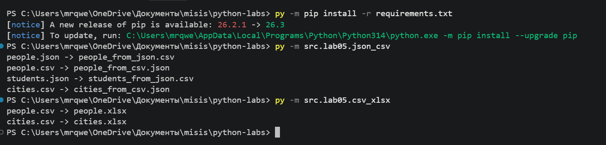

### Сценарий 1 - JSON в CSV

В [students.json](data/lab05/samples/students.json) три студента с разным набором полей:
у второго нет среднего балла, у третьего есть дополнительное поле `scholarship`.
Все ключи попадают в заголовок, пропуски остаются пустыми.

Результат [students_from_json.csv](data/lab05/out/students_from_json.csv):

```csv
fio,group,gpa,scholarship
Ильичев Тимофей Алексеевич,БИВТ-26-6-3,4.7,
Соколова Мария Андреевна,БИВТ-26-6-2,,
Орлов Никита Сергеевич,БИВТ-26-6-3,4.9,True
```

До и после конвертации — 3 записи. Для people — 5 записей,
заголовок `name,age,city`.

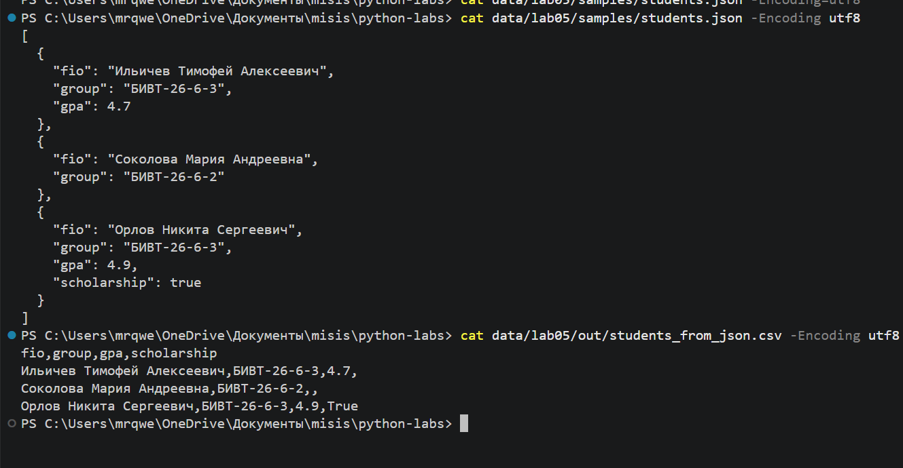

### Сценарий 2 - CSV в JSON

[people.csv](data/lab05/samples/people.csv) содержит 5 записей.
В [people_from_csv.json](data/lab05/out/people_from_csv.json) получается 5 объектов.
Ключи совпадают с заголовком CSV, возраст сохраняется строкой:

```json
{
  "name": "Alice",
  "age": "22",
  "city": "SPB"
}
```

Дополнительный пример — [cities_from_csv.json](data/lab05/out/cities_from_csv.json):
5 объектов с ключами `city`, `country`, `population`; население тоже строковое.

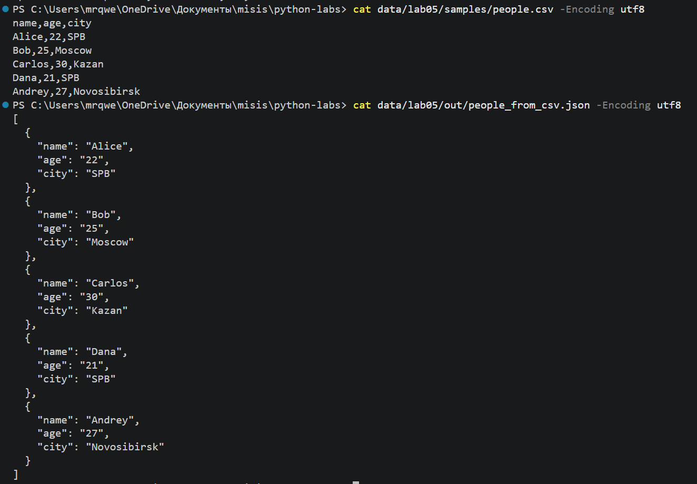

### Сценарий 3 - CSV в XLSX

[cities.csv](data/lab05/samples/cities.csv) преобразуется в
[cities.xlsx](data/lab05/out/cities.xlsx). В книге один лист `Sheet1`,
5 записей и заголовок. Ширины колонок: city — 15, country — 9, population — 12.
Длинное название `Yekaterinburg` помещается целиком.

Также создаётся [people.xlsx](data/lab05/out/people.xlsx): лист `Sheet1`,
5 записей и заголовок; ширины колонок — 8, 8 и 13.

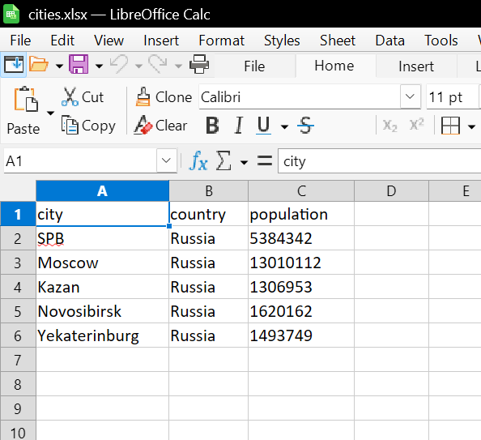

## Лабораторная работа 4

Запуск из корня проекта: `py -m src.lab04.text_report`.

### Задание A

Модуль `src/lab04/io_txt_csv.py`: `read_text` читает текстовый файл, `write_csv` записывает CSV, `ensure_parent_dir` создает папку для файла.

Кодировка по умолчанию utf-8, другую передают явно, например `encoding="cp1251"`. Ошибки FileNotFoundError и UnicodeDecodeError не перехватываются. Файл читается целиком в память, для больших файлов в реальной работе лучше читать построчно.

### Задание B

Скрипт `src/lab04/text_report.py` читает текст, считает частоты слов и сохраняет их в `report.csv` (колонки `word,count`, сначала по убыванию count, при равенстве по слову), а в консоль выводит всего слов, уникальных слов и топ-5.

Команды запуска:
- `py -m src.lab04.text_report` - читает `data/lab04/input.txt`, пишет `data/lab04/report.csv`
- `py -m src.lab04.text_report --in data/lab04/input.txt --out data/lab04/report.csv` - свои пути
- `py -m src.lab04.text_report --in data/lab04/input_cp1251.txt --encoding cp1251` - файл в другой кодировке

Кодировки: вход читается в utf-8, другая кодировка задается флагом `--encoding cp1251`. CSV-отчет всегда пишется в utf-8. Если кодировка не подошла или файла нет, скрипт печатает сообщение и выходит с кодом 1.

Пустой вход: если файл пустой, в `report.csv` пишется только заголовок `word,count`.

Тест A - обычный файл (`Привет, мир! Привет!!!`)
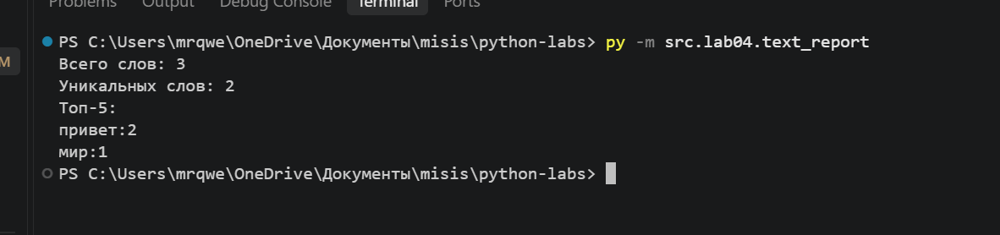

Тест B - пустой файл
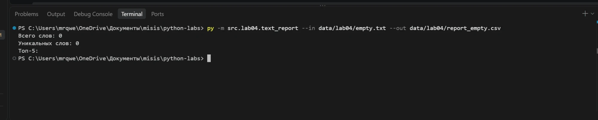

Тест C - кодировка cp1251
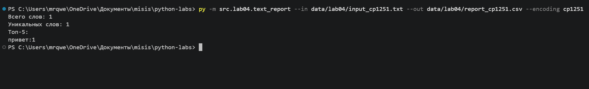


# Лабораторная работа 3

## Задание 1 - Нормализация текста

Функция normalize приводит строку к единому виду: нижний регистр, ё заменена на е, лишние пробелы убраны.

Сначала проверяем, что на входе строка, иначе TypeError. Дальше через if-else приводим текст к нижнему регистру: casefold() или lower(), в зависимости от флага casefold. Если включен yo2e, заменяем ё на е через .replace(). В конце text.split() без аргументов сам режет строку по любым пробельным символам (\t, \r, \n и повторяющимся пробелам), а " ".join() склеивает слова обратно через один пробел, так что края заодно обрезаются. Флаги casefold и yo2e именованные (после *).

Файл: src/lib/text.py

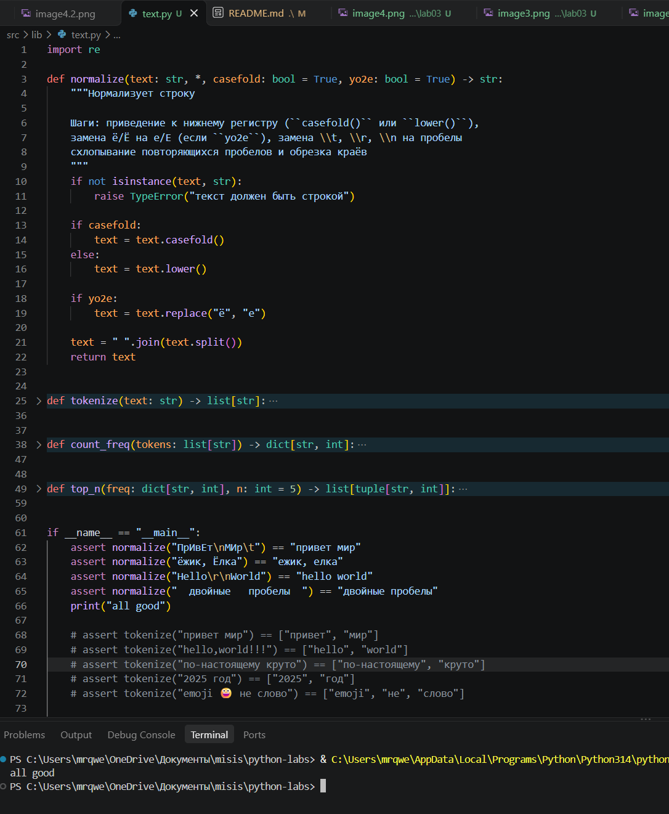

## Задание 2 - Токенизация

Функция tokenize достает из текста слова: буквы, цифры, подчеркивание, а дефис внутри слова остается.

Слова ищем регулярным выражением \w+(?:-\w+)* через re.findall(). Часть \w+ берет обычное слово, а группа (?:-\w+)* разрешает дефис между частями, поэтому по-настоящему остается одним токеном. Числа тоже считаются словами, а эмодзи, знаки препинания и длинное тире работают как разделители и пропадают. Если на входе не строка, бросаем TypeError.

Файл: src/lib/text.py

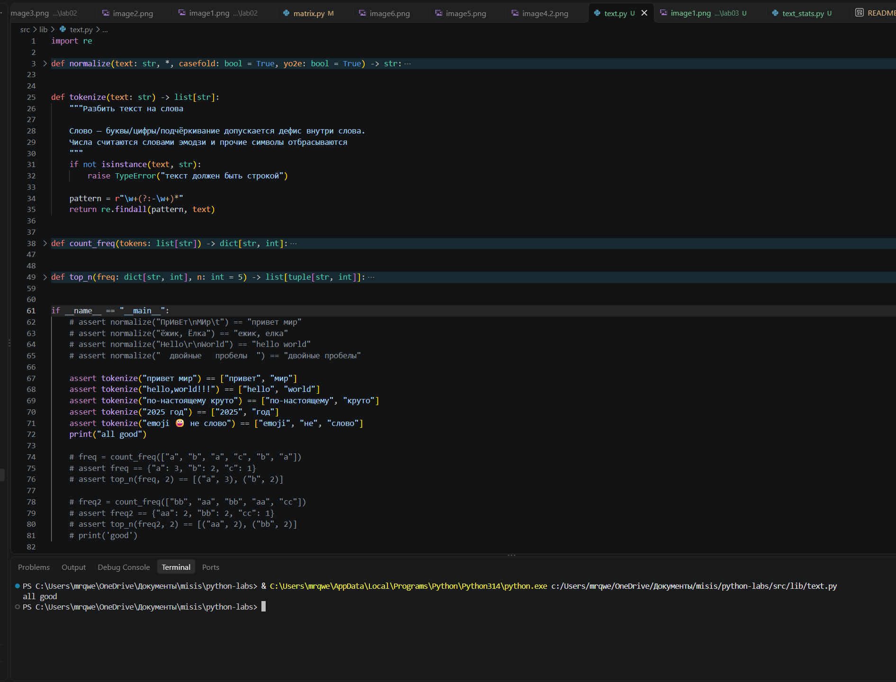

## Задание 3 - Частоты слов

Функция count_freq считает, сколько раз каждое слово встречается в списке токенов.

Заводим пустой словарь d и идем по токенам циклом for. Если слова в словаре еще нет, записываем ему 1, а если уже есть, прибавляем единицу. Возвращаем словарь вида слово → количество.

Файл: src/lib/text.py

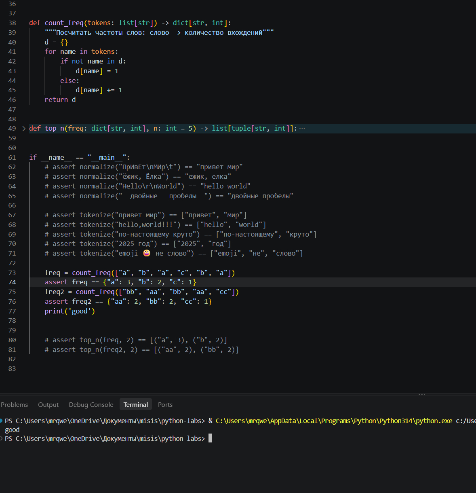

## Задание 4 - Топ-N

Функция top_n возвращает n самых частых слов вместе с их количеством.

Сортируем пары (слово, частота) через sorted() по ключу (-x[1], x[0]): минус перед частотой дает порядок по убыванию, а при равных частотах слова идут по алфавиту. Потом берем срез [:n]. Если n меньше нуля, бросаем ValueError.

Файл: src/lib/text.py

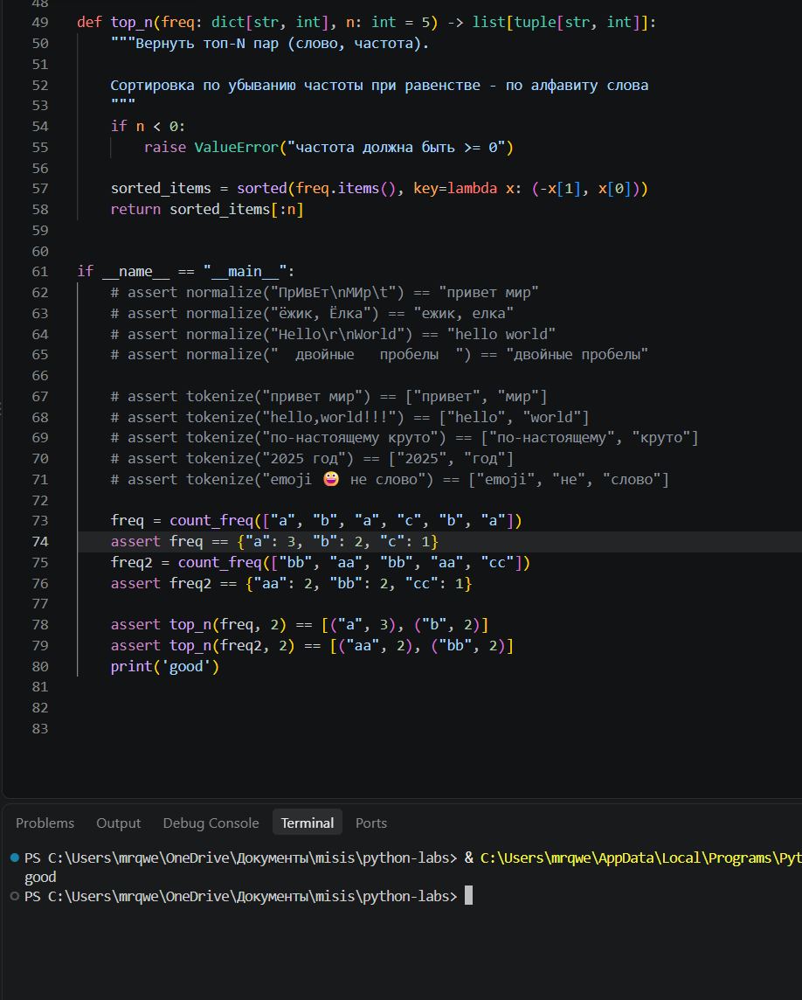

## Задание 5 - Статистика текста

Скрипт читает строку из stdin и печатает сколько всего слов, сколько уникальных и топ-5 самых частых.

Строку читаем одной командой input() (весь ввод до EOF не читаем). Потом по цепочке вызываем функции из lib/text.py: normalize, tokenize, count_freq и top_n. Всего слов это длина списка токенов, уникальных слов это длина словаря частот. Топ-5 печатаем циклом в формате слово:кол-во. Запускать из корня репозитория как модуль.

Пример запуска:
```
$ echo "Привет, мир! Привет!!!" | py -m src.lab03.text_stats
Всего слов: 3
Уникальных слов: 2
Топ-5:
привет:2
мир:1
```

Файл: src/lab03/text_stats.py

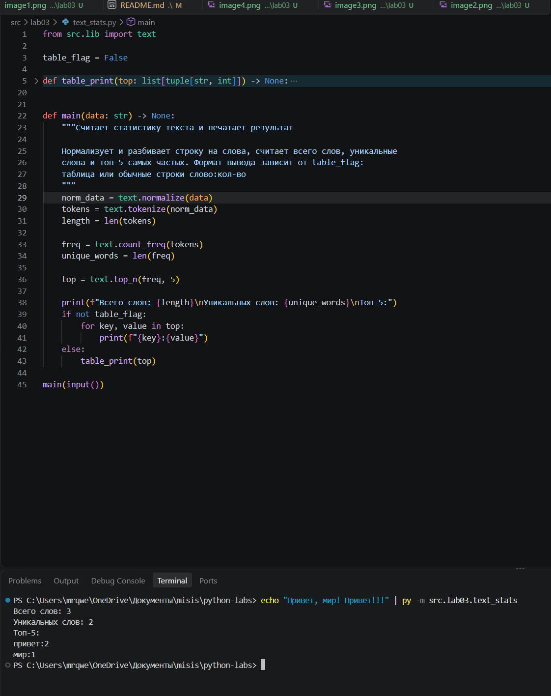

## Задание 6 - Табличный вывод

Тот же скрипт, но топ слов печатается в виде ровной таблицы со столбцами слово и частота.

Режим включается переменной table_flag в начале файла: при True работает функция table_print, при False остается обычный вывод слово:кол-во. Внутри table_print сначала в цикле находим самое длинное слово из топа, начиная с длины заголовка "слово", чтобы столбец всегда помещался. Дальше слова выравниваем по левому краю через f-строку {key:<{width}}, а линию под заголовком делаем из width + 10 дефисов (ширина столбца, разделитель " | " и слово "частота"). Строки "Всего слов", "Уникальных слов" и "Топ-5:" печатаются в обоих режимах.

Пример запуска:
```
$ echo "Привет, мир! Привет!!!" | py -m src.lab03.text_stats
Всего слов: 3
Уникальных слов: 2
Топ-5:
слово  | частота
----------------
привет | 2
мир    | 1
```

Файл: src/lab03/text_stats.py

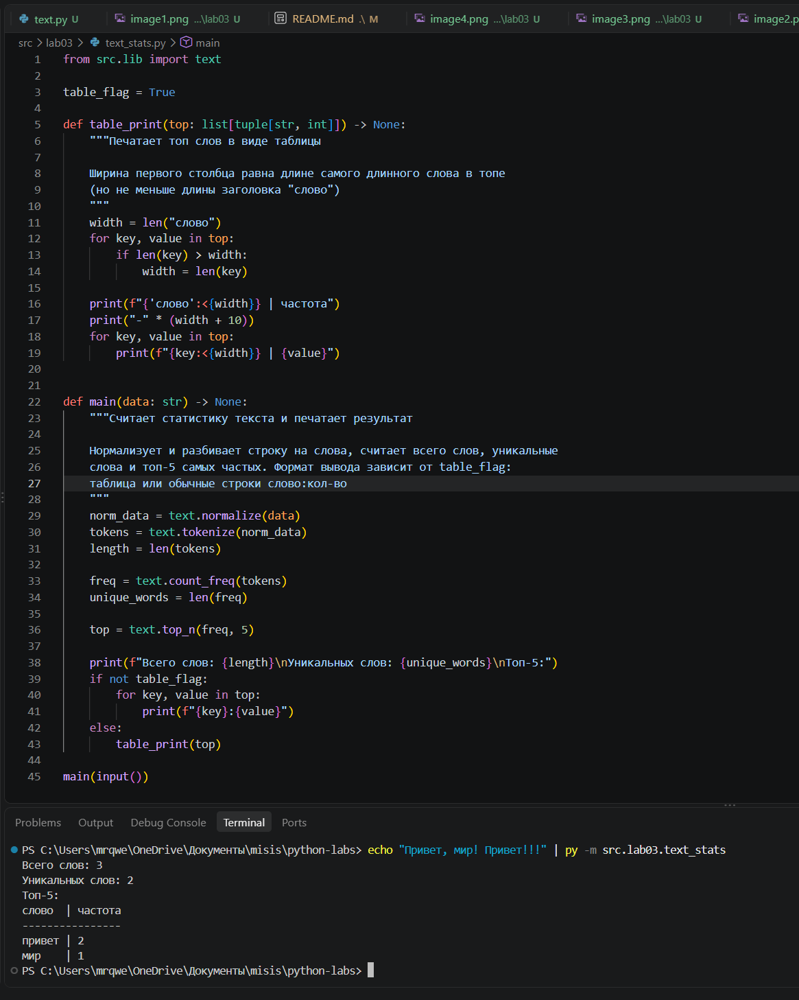


# Лабораторная работа 2

## Задание 1 - Минимум и максимум

Функция min_max находит в списке чисел минимум и максимум и возвращает их кортежем.

Берем первый элемент списка как начальный минимум и максимум, а потом в цикле for проходим по всем числам и обновляем их, если встретили меньшее или большее значение. Встроенные min() и max() использовать нельзя. Если на входе не список, бросаем TypeError, а если список пустой, то ValueError.

Файл: src/lab02/arrays.py

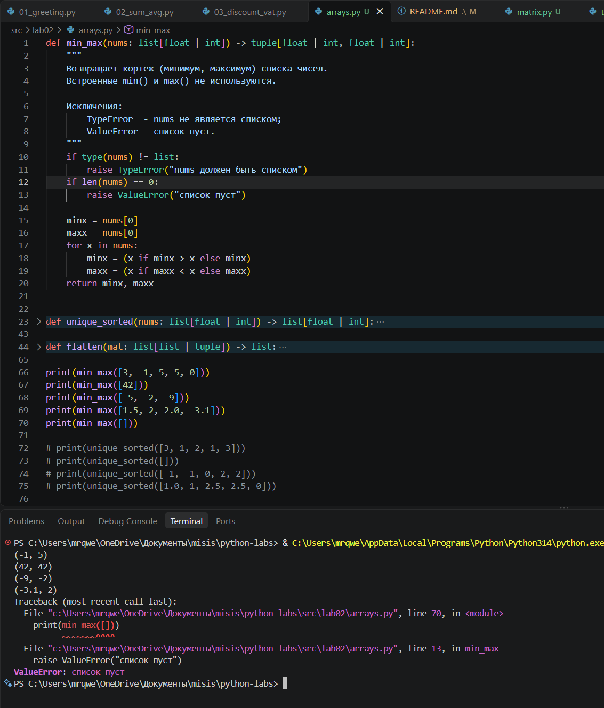

## Задание 2 - Уникальные и отсортированные

Функция unique_sorted убирает из списка повторы и возвращает значения по возрастанию.

Сначала превращаем список в set(), чтобы убрать дубли, и обратно в список. Потом сортируем его выбором двумя вложенными циклами: на каждом шаге ищем индекс наименьшего элемента среди оставшихся и меняем его местами с текущим. Встроенные sorted() и sort() использовать нельзя. Пустой список возвращает пустой список.

Файл: src/lab02/arrays.py

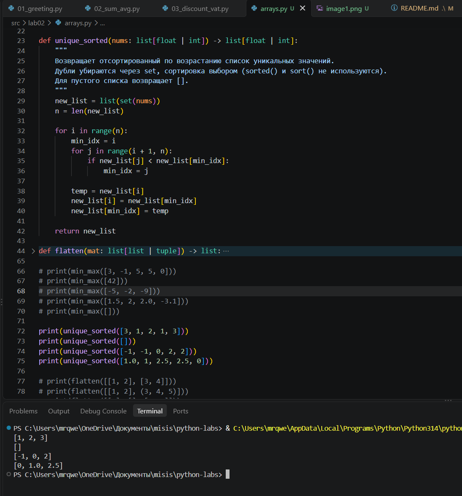

## Задание 3 - Расплющить список

Функция flatten превращает список списков и кортежей в один плоский список по строкам.

Сначала проверяем, что на входе список, иначе TypeError. Потом идем по каждой строке, и если она не список и не кортеж, тоже бросаем TypeError. Внутренним циклом дописываем элементы строки в общий список row. Пустые строки просто ничего не добавляют.

Файл: src/lab02/arrays.py

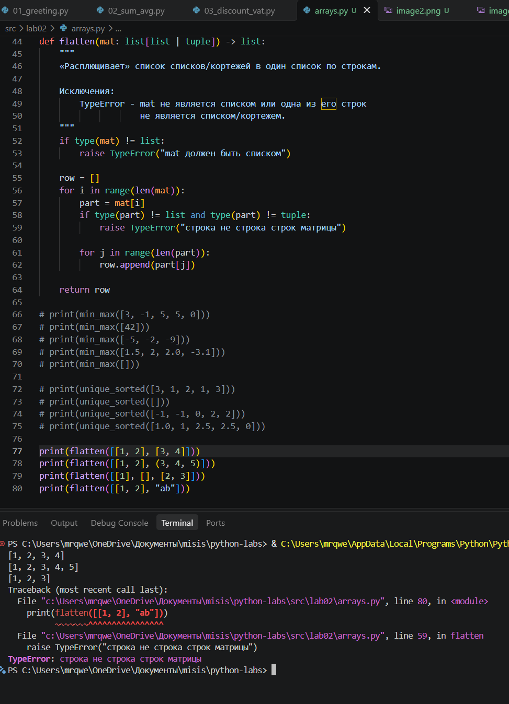

## Задание 4 - Транспонирование

Функция transpose меняет строки и столбцы матрицы местами.

Сначала вспомогательная функция check берет длину первой строки и сравнивает с ней все остальные, если длины разные, то матрица рваная и бросается ValueError. Дальше внешний цикл идет по столбцам, а внутренний собирает один столбец сверху вниз в новый список, который становится строкой результата. Пустая матрица [] возвращает [].

Файл: src/lab02/matrix.py

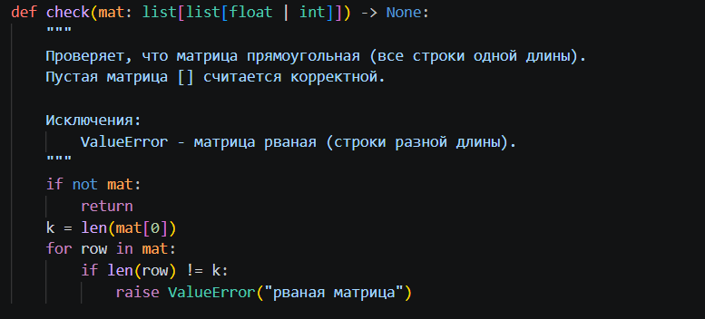
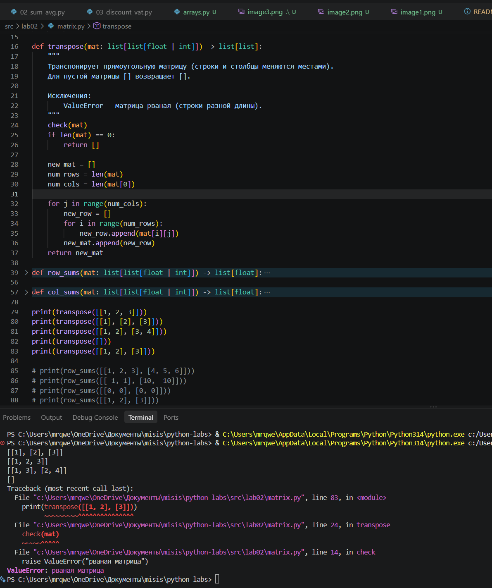

## Задание 5 - Суммы по строкам

Функция row_sums считает сумму чисел в каждой строке матрицы.

Сначала проверяем матрицу через check, чтобы она была прямоугольной. Потом в цикле идем по строкам, считаем сумму каждой через sum() и дописываем в список результата. Для рваной матрицы бросается ValueError, для пустой возвращается [].

Файл: src/lab02/matrix.py


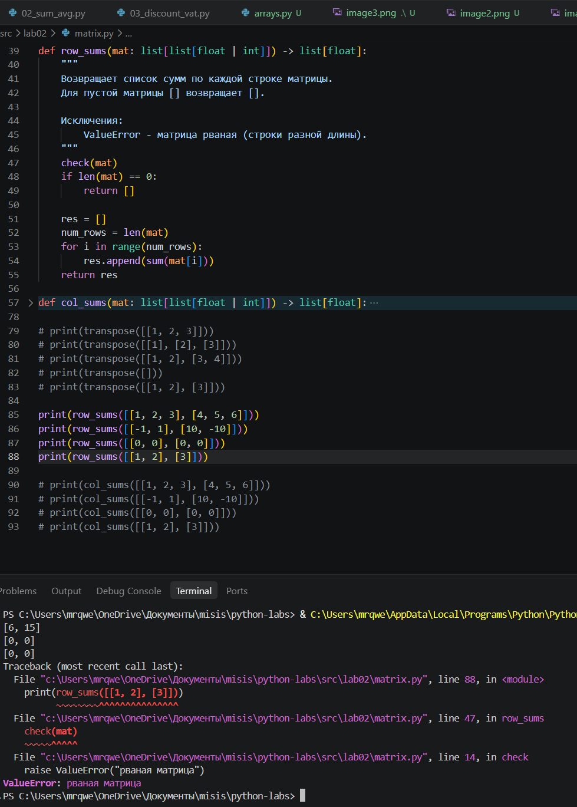

## Задание 6 - Суммы по столбцам

Функция col_sums считает сумму чисел в каждом столбце матрицы.

После проверки через check создаем список нулей по числу столбцов. Затем двумя вложенными циклами проходим по всем элементам и прибавляем каждый к сумме своего столбца. Для рваной матрицы бросается ValueError, для пустой возвращается [].

Файл: src/lab02/matrix.py


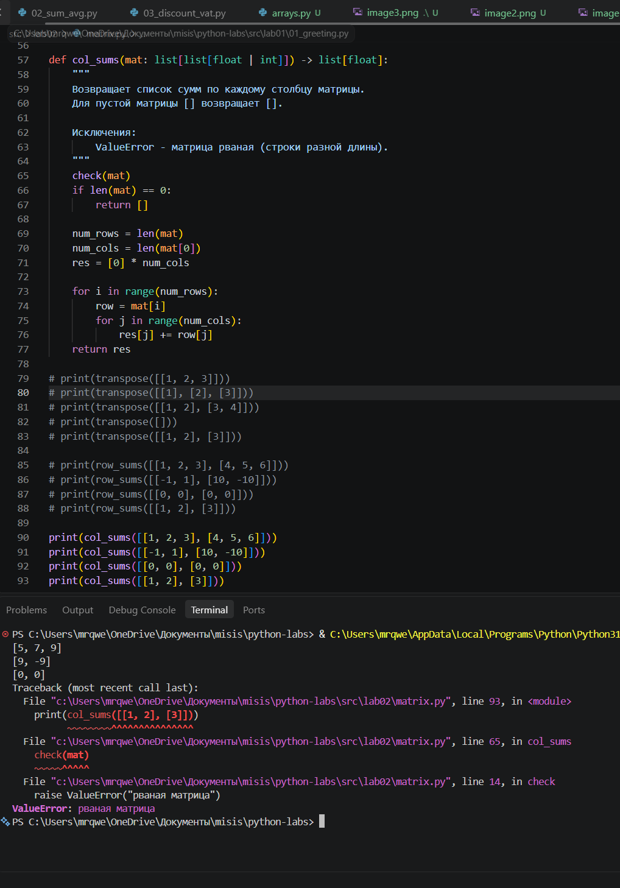

## Задание 7 - Запись студента

Функция format_record берет запись студента в виде кортежа (ФИО, группа, GPA) и возвращает строку вида Иванов И.И., гр. BIVT-25, GPA 4.60.

Тип записи задаем алиасом Record = tuple[str, str, float], а сам кортеж распаковываем в три переменные. Типы проверяем через type(), при ошибке бросаем TypeError. ФИО разбиваем через .split(), он сам убирает лишние пробелы, а группу чистим через .strip(). Если ФИО не из 2-3 слов, группа пустая или GPA вне диапазона от 0 до 5, бросаем ValueError. Фамилию делаем с заглавной буквы через .capitalize(), инициалы собираем из первых букв имени и отчества в верхнем регистре через join, а GPA выводим в f-строке с двумя знаками (:.2f).

Файл: src/lab02/tuples.py

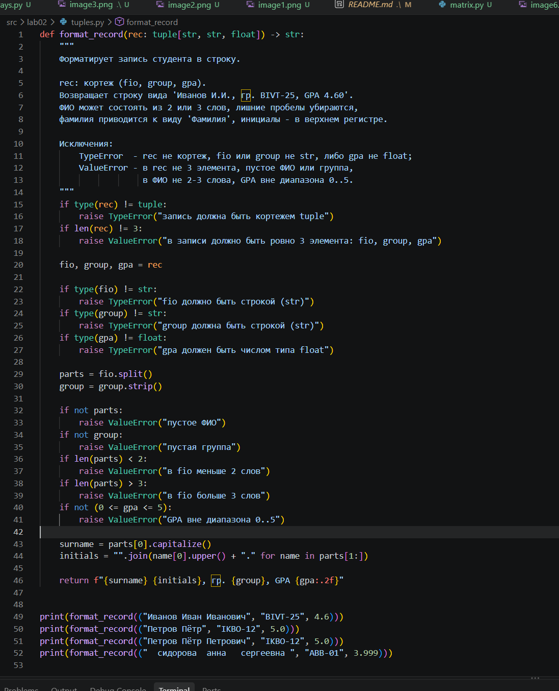
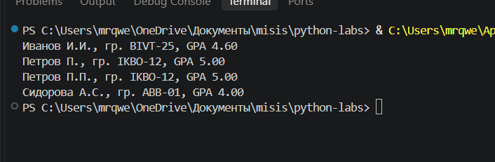


# Лабараторная работа 1

## Задание 1 - Приветствие
Спрашивает имя и возраст, потом здоровается и говорит сколько будет через год.

Сначала через input() и int() запрашиваем у пользователя имя и превращаем введенный возраст в число. Потом прямо внутри f-строки прибавляем к возрасту единицу и выводим готовый текст на экран.

Файл: src/01_greeting.py

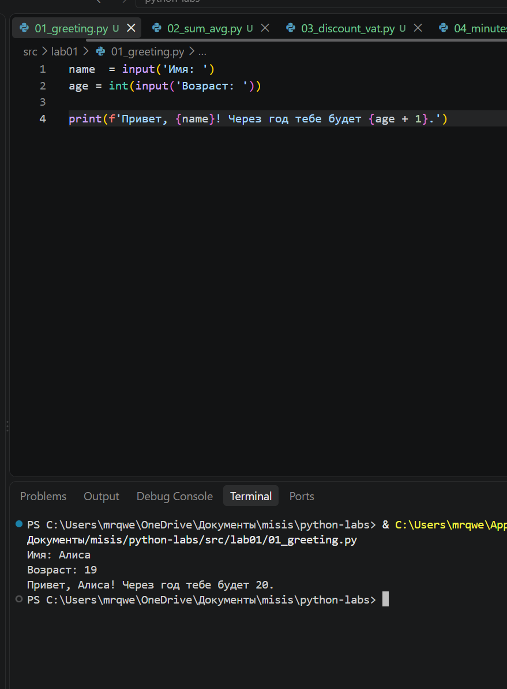

## Задание 2 - Сумма и среднее
Вводишь два числа, программа считает сумму и среднее(понимает ,).

Здесь через float(input()) принимаем от пользователя два числа и сразу превращаем их в дробные. В конце в одной f-строке складываем их, считаем среднее арифметическое и округляем результат до двух знаков после запятой с помощью :.2f.

Файл: src/02_sum_avg.py

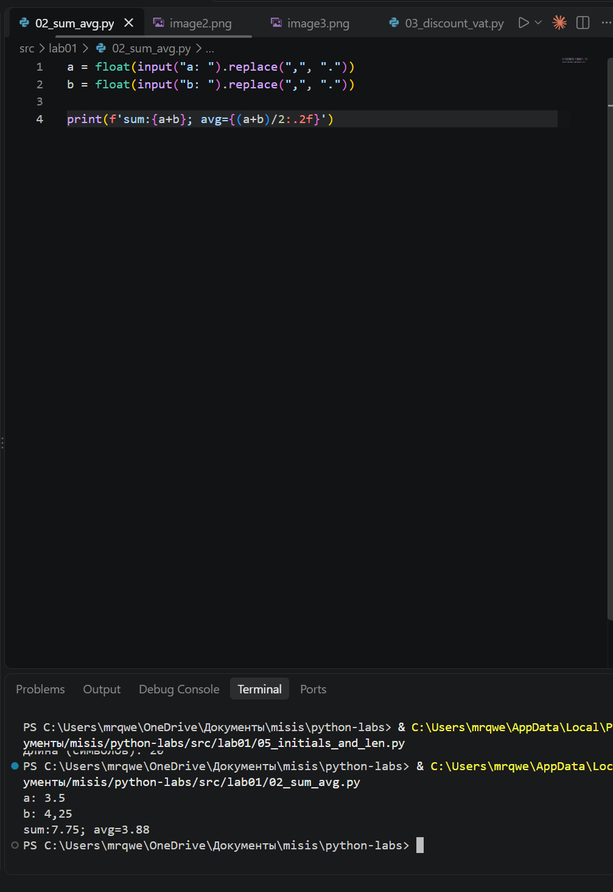

## Задание 3 - Скидка и НДС

Вводишь цену, скидку и НДС в процентах. Считает сколько платить в итоге.

Считываем три числа через int(input()), а затем по формулам высчитываем цену со скидкой, сумму НДС и итоговую стоимость. В конце выводим все три значения с новой строки (\n), округляя копейки до двух знаков через :.2f.

Файл: src/03_discount_vat.py

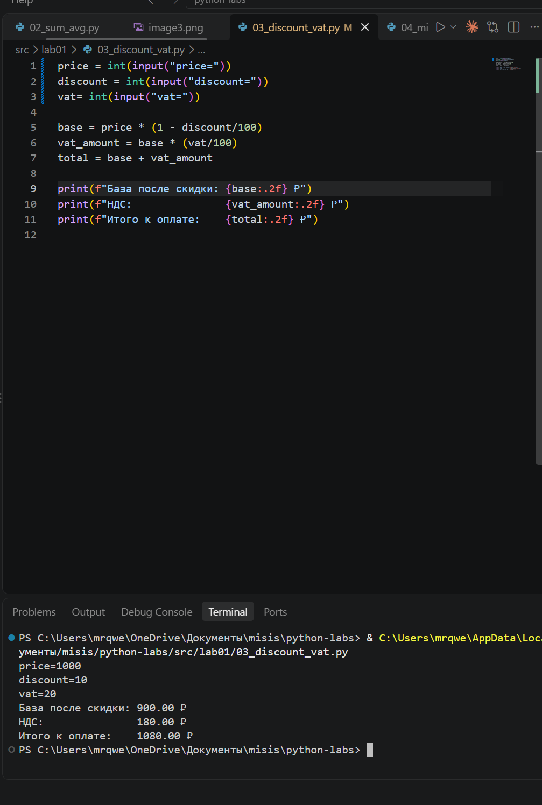
## Задание 4 - Минуты в часы

Вводишь минуты, получаешь часы и минуты, типа 135 это 2:15.

Запрашиваем общее количество минут через int(input()) и делим его на 60 нацело (//), чтобы узнать часы. Минуты находим через остаток от деления (%), а в f-строке используем :02d, чтобы в выводе всегда было две цифры (например, 05 вместо 5).

Файл: src/04_minutes_to_hhmm.py

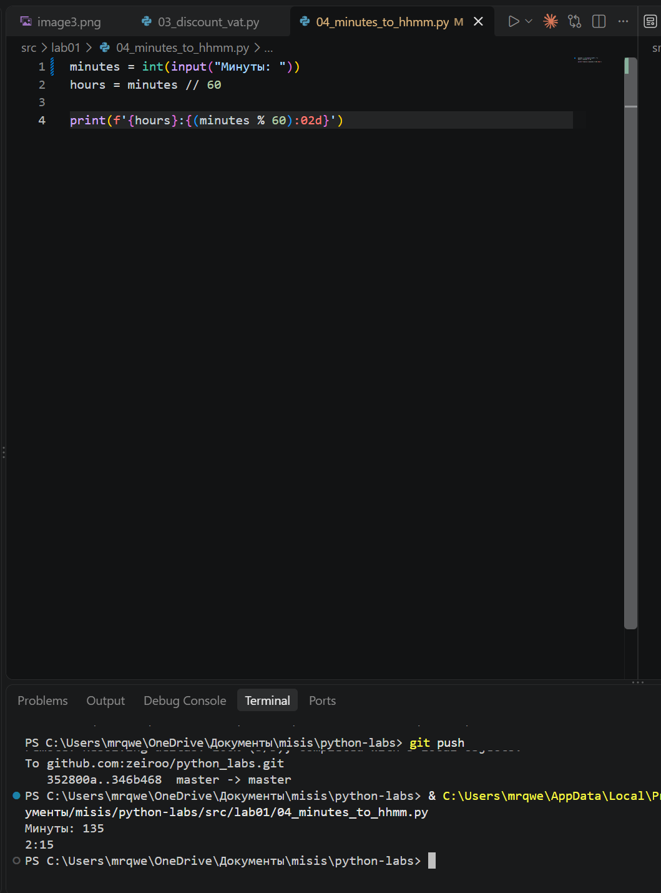

## Задание 5 - Инициалы

Вводишь ФИО, программа делает из него инициалы и считает сколько символов в ФИО целиком.

Разбиваем введенную строку по пробелам через .split(), чтобы получить отдельные элементы для фамилии, имени и отчества. Затем вытаскиваем первые буквы для инициалов, складываем длины всех трех слов через len() и выводим результат в два столбика(+2 пробела внутри ФИО).

Файл: src/05_initials_and_len.py

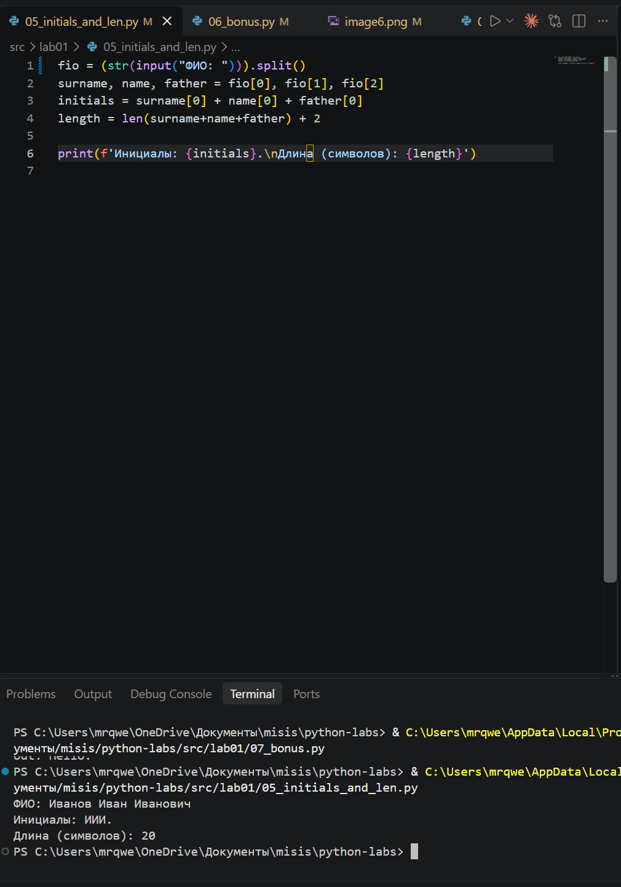

## Задание 6 - Студенты

Сначала пишешь сколько студентов, инфу про каждого. В конце показывает сколько очники и сколько заочники.

Сначала заводим счетчики для очников и заочников, а потом в цикле for крутимся столько раз, сколько ввел пользователь. На каждом шаге бьем строку через .split() по переменным и через обычный if-elif проверяем форму обучения, докидывая по единичке в нужный счетчик.

Файл: src/06.py

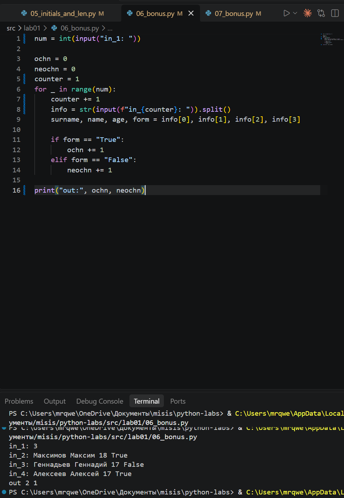

## Задание 7 - Шифр

Расшифровывает слово.

Через первый цикл for находим первую заглавную букву строки, запоминаем её индекс и прерываемся. Во втором цикле ищем ближайшую цифру, чтобы по разнице индексов высчитать шаг, а в третьем цикле шагаем по строке с этим шагом и дописываем буквы в результат.

Файл: src/07.py

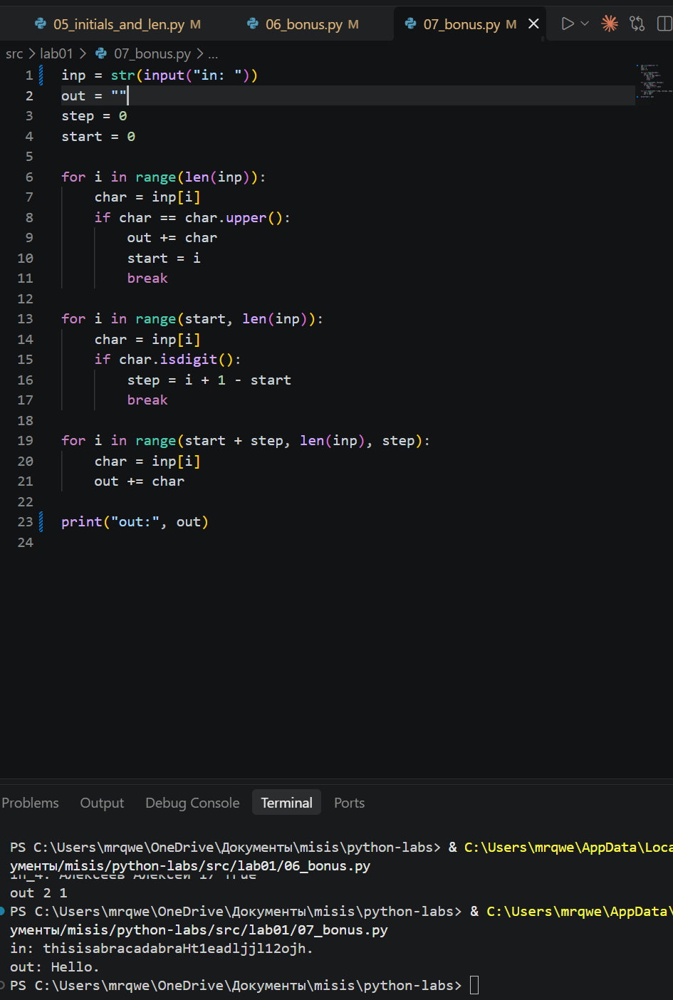
