Ильичев Тимофей Алексеевич БИВТ 26-6-3

# Лабораторная работа 2

## Задание 1 — Минимум и максимум

Функция min_max находит в списке чисел минимум и максимум и возвращает их кортежем.

Берем первый элемент списка как начальный минимум и максимум, а потом в цикле for проходим по всем числам и обновляем их, если встретили меньшее или большее значение. Встроенные min() и max() использовать нельзя. Если на входе не список, бросаем TypeError, а если список пустой, то ValueError.

Файл: src/lab02/arrays.py

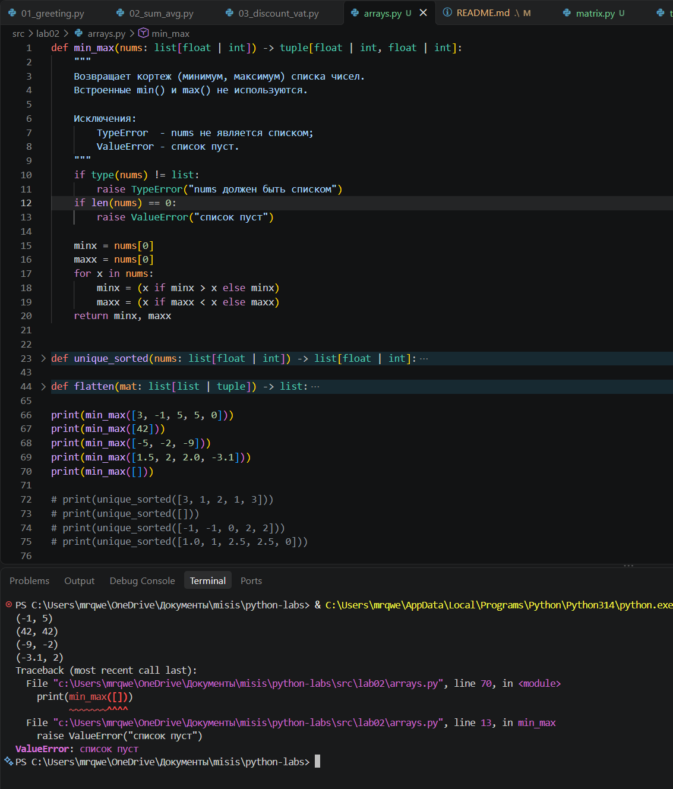

## Задание 2 — Уникальные и отсортированные

Функция unique_sorted убирает из списка повторы и возвращает значения по возрастанию.

Сначала превращаем список в set(), чтобы убрать дубли, и обратно в список. Потом сортируем его выбором двумя вложенными циклами: на каждом шаге ищем индекс наименьшего элемента среди оставшихся и меняем его местами с текущим. Встроенные sorted() и sort() использовать нельзя. Пустой список возвращает пустой список.

Файл: src/lab02/arrays.py

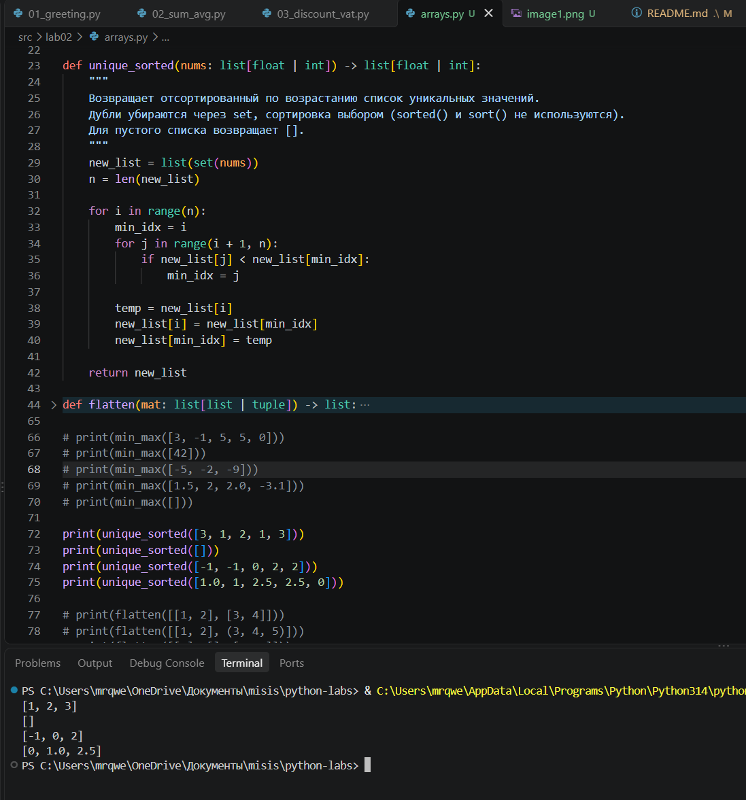

## Задание 3 — Расплющить список

Функция flatten превращает список списков и кортежей в один плоский список по строкам.

Сначала проверяем, что на входе список, иначе TypeError. Потом идем по каждой строке, и если она не список и не кортеж, тоже бросаем TypeError. Внутренним циклом дописываем элементы строки в общий список row. Пустые строки просто ничего не добавляют.

Файл: src/lab02/arrays.py

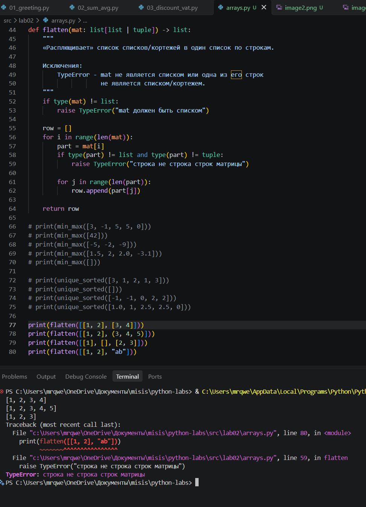

## Задание 4 — Транспонирование

Функция transpose меняет строки и столбцы матрицы местами.

Сначала вспомогательная функция check берет длину первой строки и сравнивает с ней все остальные, если длины разные, то матрица рваная и бросается ValueError. Дальше внешний цикл идет по столбцам, а внутренний собирает один столбец сверху вниз в новый список, который становится строкой результата. Пустая матрица [] возвращает [].

Файл: src/lab02/matrix.py

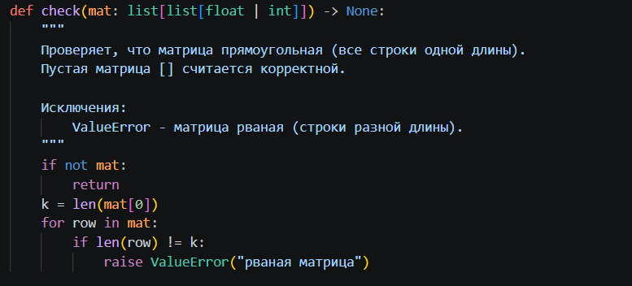
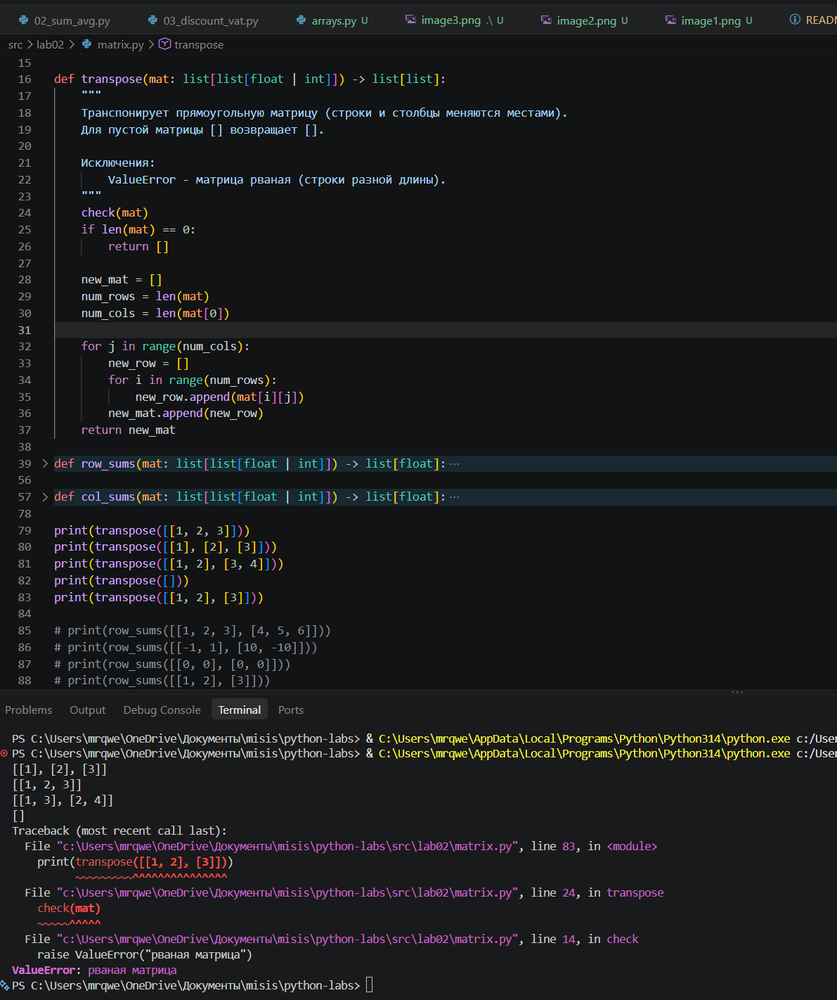

## Задание 5 — Суммы по строкам

Функция row_sums считает сумму чисел в каждой строке матрицы.

Сначала проверяем матрицу через check, чтобы она была прямоугольной. Потом в цикле идем по строкам, считаем сумму каждой через sum() и дописываем в список результата. Для рваной матрицы бросается ValueError, для пустой возвращается [].

Файл: src/lab02/matrix.py

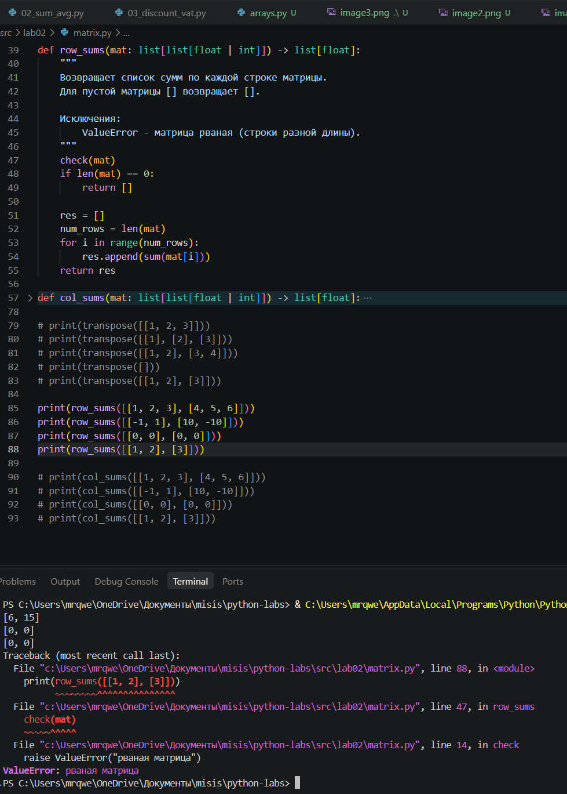

## Задание 6 — Суммы по столбцам

Функция col_sums считает сумму чисел в каждом столбце матрицы.

После проверки через check создаем список нулей по числу столбцов. Затем двумя вложенными циклами проходим по всем элементам и прибавляем каждый к сумме своего столбца. Для рваной матрицы бросается ValueError, для пустой возвращается [].

Файл: src/lab02/matrix.py

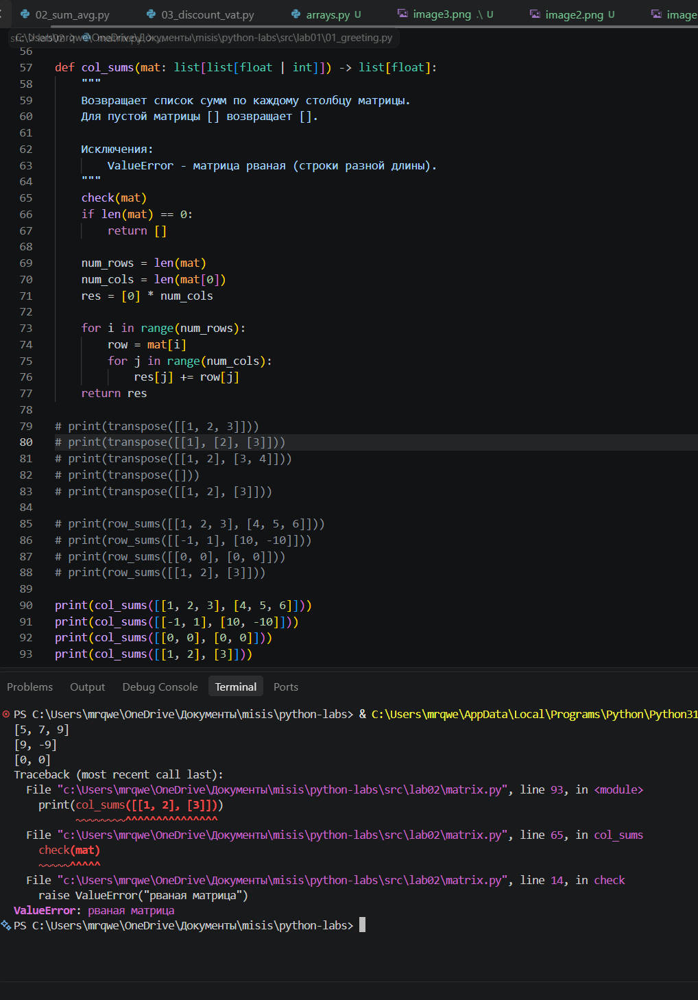

## Задание 7 — Запись студента

Функция format_record берет запись студента в виде кортежа (ФИО, группа, GPA) и возвращает строку вида Иванов И.И., гр. BIVT-25, GPA 4.60.

Тип записи задаем алиасом Record = tuple[str, str, float], а сам кортеж распаковываем в три переменные. Типы проверяем через type(), при ошибке бросаем TypeError. ФИО разбиваем через .split(), он сам убирает лишние пробелы, а группу чистим через .strip(). Если ФИО не из 2-3 слов, группа пустая или GPA вне диапазона от 0 до 5, бросаем ValueError. Фамилию делаем с заглавной буквы через .capitalize(), инициалы собираем из первых букв имени и отчества в верхнем регистре через join, а GPA выводим в f-строке с двумя знаками (:.2f).

Файл: src/lab02/tuples.py

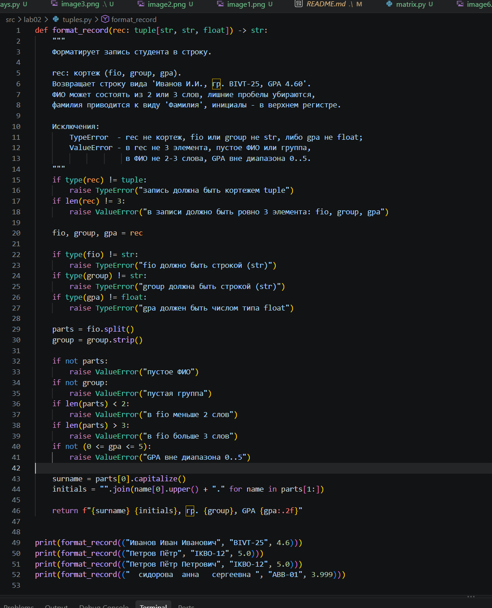
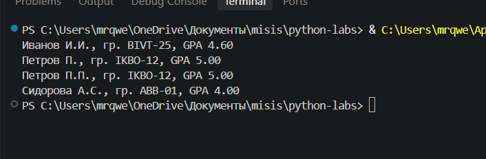

# Лабараторная работа 1

## Задание 1 — Приветствие
Спрашивает имя и возраст, потом здоровается и говорит сколько будет через год.

Сначала через input() и int() запрашиваем у пользователя имя и превращаем введенный возраст в число. Потом прямо внутри f-строки прибавляем к возрасту единицу и выводим готовый текст на экран.

Файл: src/01_greeting.py

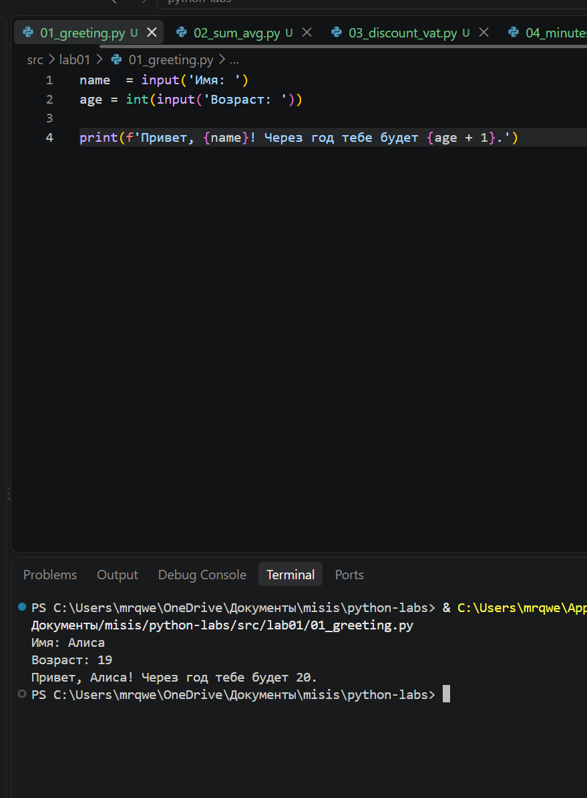

## Задание 2 — Сумма и среднее
Вводишь два числа, программа считает сумму и среднее(понимает ,).

Здесь через float(input()) принимаем от пользователя два числа и сразу превращаем их в дробные. В конце в одной f-строке складываем их, считаем среднее арифметическое и округляем результат до двух знаков после запятой с помощью :.2f.

Файл: src/02_sum_avg.py

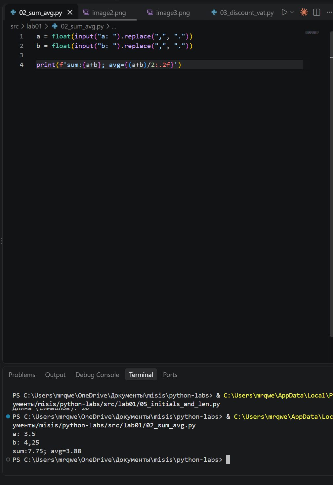

## Задание 3 — Скидка и НДС

Вводишь цену, скидку и НДС в процентах. Считает сколько платить в итоге.

Считываем три числа через int(input()), а затем по формулам высчитываем цену со скидкой, сумму НДС и итоговую стоимость. В конце выводим все три значения с новой строки (\n), округляя копейки до двух знаков через :.2f.

Файл: src/03_discount_vat.py

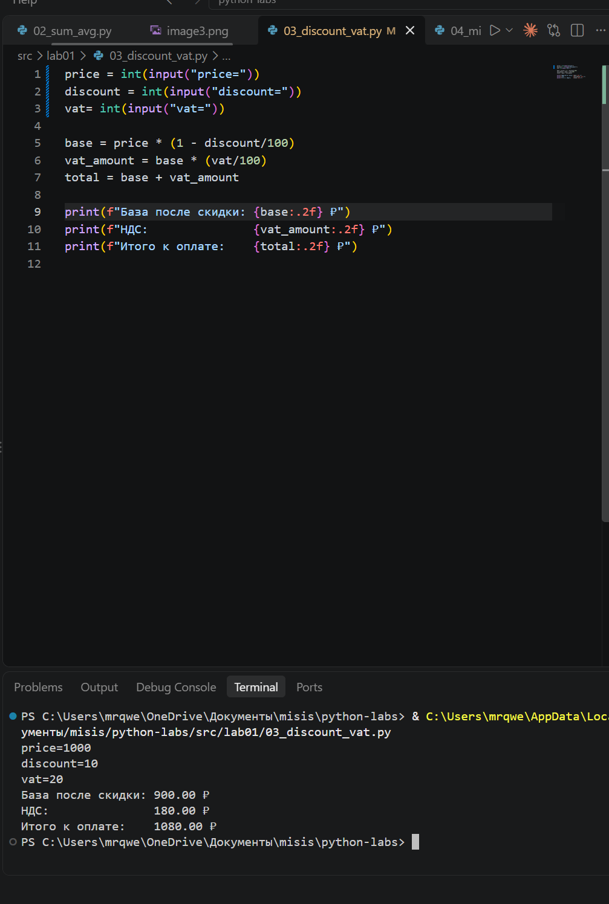
## Задание 4 — Минуты в часы

Вводишь минуты, получаешь часы и минуты, типа 135 это 2:15.

Запрашиваем общее количество минут через int(input()) и делим его на 60 нацело (//), чтобы узнать часы. Минуты находим через остаток от деления (%), а в f-строке используем :02d, чтобы в выводе всегда было две цифры (например, 05 вместо 5).

Файл: src/04_minutes_to_hhmm.py

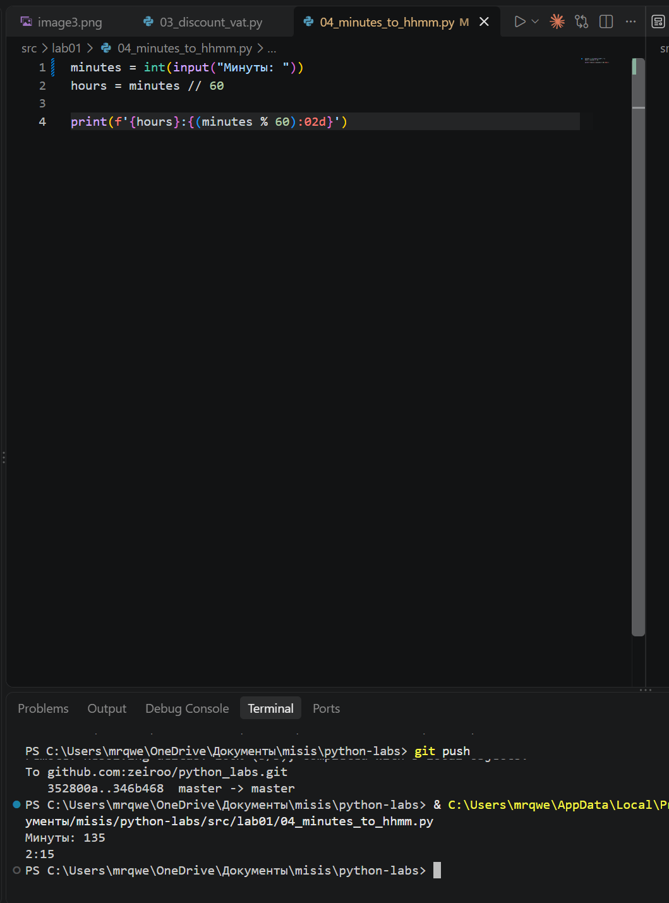

## Задание 5 — Инициалы

Вводишь ФИО, программа делает из него инициалы и считает сколько символов в ФИО целиком.

Разбиваем введенную строку по пробелам через .split(), чтобы получить отдельные элементы для фамилии, имени и отчества. Затем вытаскиваем первые буквы для инициалов, складываем длины всех трех слов через len() и выводим результат в два столбика(+2 пробела внутри ФИО).

Файл: src/05_initials_and_len.py

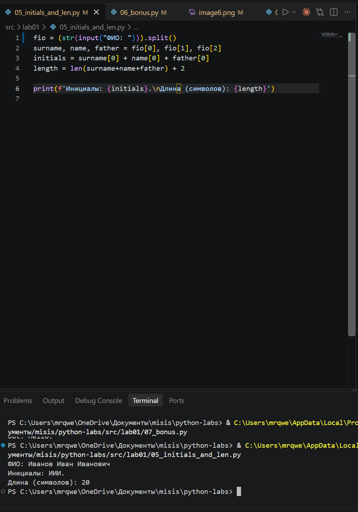

## Задание 6 — Студенты

Сначала пишешь сколько студентов, инфу про каждого. В конце показывает сколько очники и сколько заочники.

Сначала заводим счетчики для очников и заочников, а потом в цикле for крутимся столько раз, сколько ввел пользователь. На каждом шаге бьем строку через .split() по переменным и через обычный if-elif проверяем форму обучения, докидывая по единичке в нужный счетчик.

Файл: src/06.py

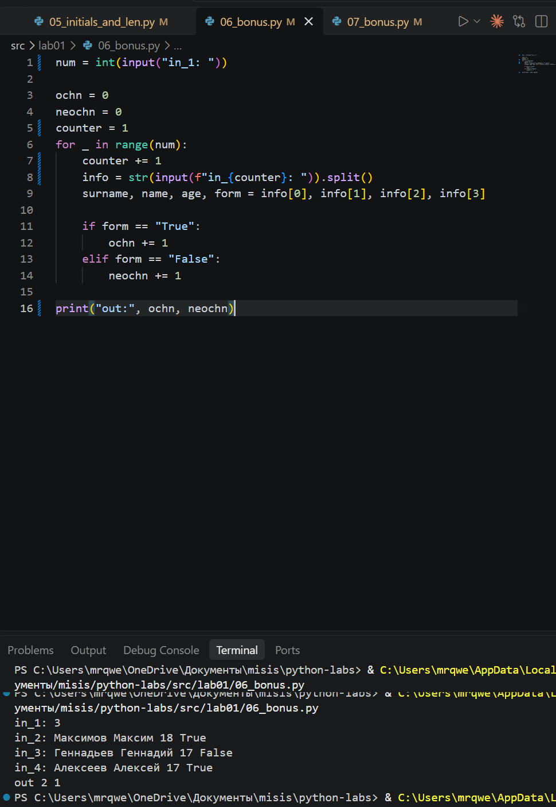

## Задание 7 — Шифр

Расшифровывает слово.

Через первый цикл for находим первую заглавную букву строки, запоминаем её индекс и прерываемся. Во втором цикле ищем ближайшую цифру, чтобы по разнице индексов высчитать шаг, а в третьем цикле шагаем по строке с этим шагом и дописываем буквы в результат.

Файл: src/07.py

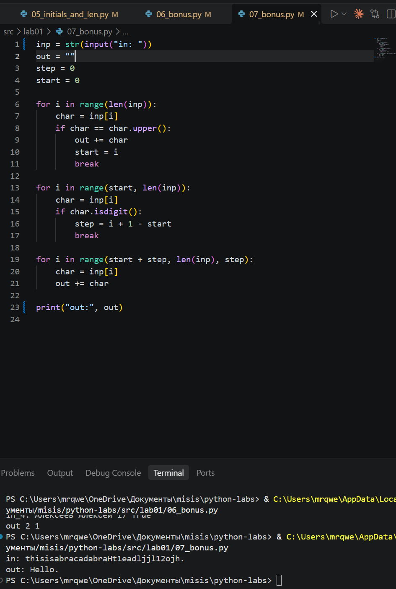