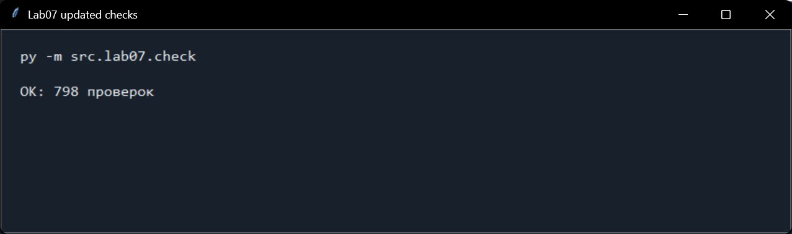
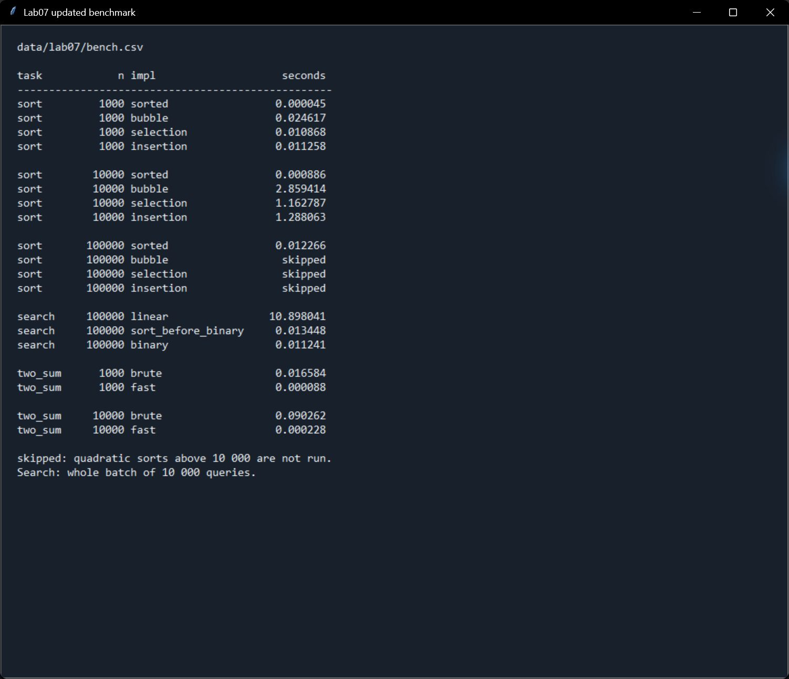

# Лабораторная работа 7 — поиск, сортировка и измерение времени

Python 3.10+. Запуск из корня проекта, дополнительные библиотеки не требуются.

```powershell
py -m src.lab07.check
py -m src.lab07.bench
```

## Задание A — поиск

В [search.py](search.py) реализованы линейный и бинарный поиск и две версии Two Sum.
Линейный поиск возвращает индекс первого вхождения, бинарный — любого вхождения
в отсортированном списке. Если элемент отсутствует, возвращается `-1`.
Two Sum реализован перебором пар и за один проход через словарь;
результат — пара индексов `(i, j)`, где `i < j`, либо `None`.

## Задание B — сортировки

В [sorting.py](sorting.py) реализованы `bubble_sort`, `insertion_sort`
и `selection_sort`. Все возвращают новый список, исходный не меняется.
Готовые функции сортировки, `min` и `max` внутри не используются.
В пузырьке добавлен ранний выход при отсутствии обменов.

## Задание C — проверка

[check.py](check.py) содержит `check_sorting`, `check_search`, `check_two_sum` и `main`.
Каждая сортировка проверяется на 100 случайных списках длиной 0–50
со значениями от −100 до 100: результат сравнивается с `sorted`,
проверяются сохранность входного списка и создание нового объекта.
Поиск сравнивается с `list.index`, дополнительно проверяются края,
пустой список, один и два элемента. Для Two Sum выполняются 100 случайных
прогонов: сравнивается существование ответа, проверяются индексы и сумма.
При расхождении `assert` выводит входные данные.

```text
OK: 798 проверок
```



## Задание D — замеры

[bench.py](bench.py) измеряет время через `timeit` и сохраняет таблицу
в [bench.csv](../../data/lab07/bench.csv) через `write_csv` из ЛР4.
Данные генерируются до замера, для сравниваемых алгоритмов используются одинаковые
списки и `random.seed(42)`. Время быстрых операций усредняется по нескольким запускам.

- Сортировки: 1 000, 10 000 и 100 000 элементов. Свои квадратичные сортировки
  запускаются до 10 000 включительно; `skipped` означает пропуск по ограничению размера.
- Поиск: 10 000 существующих запросов к списку из 100 000 элементов.
  Указано время всего пакета; предварительная сортировка измерена отдельно.
- Two Sum: 1 000 и 10 000 элементов, цель равна сумме последних двух чисел.
  Ответ гарантированно существует, но другая подходящая пара может встретиться раньше.

Время указано в секундах. Замеры выполнены на Python 3.14.0, Windows AMD64.

| task | n | impl | seconds |
|---|---:|---|---:|
| sort | 1000 | sorted | 0.000045 |
| sort | 1000 | bubble | 0.024617 |
| sort | 1000 | selection | 0.010868 |
| sort | 1000 | insertion | 0.011258 |
| sort | 10000 | sorted | 0.000886 |
| sort | 10000 | bubble | 2.859414 |
| sort | 10000 | selection | 1.162787 |
| sort | 10000 | insertion | 1.288063 |
| sort | 100000 | sorted | 0.012266 |
| sort | 100000 | bubble | skipped |
| sort | 100000 | selection | skipped |
| sort | 100000 | insertion | skipped |
| search | 100000 | linear | 10.898041 |
| search | 100000 | sort_before_binary | 0.013448 |
| search | 100000 | binary | 0.011241 |
| two_sum | 1000 | brute | 0.016584 |
| two_sum | 1000 | fast | 0.000088 |
| two_sum | 10000 | brute | 0.090262 |
| two_sum | 10000 | fast | 0.000228 |



## Выводы

При увеличении n с 1 000 до 10 000 пузырёк замедлился примерно в 116 раз:
0,024617 → 2,859414 с. Это согласуется с O(n²), для которой увеличение размера
в 10 раз даёт примерно стократный рост работы. У `sorted` время выросло
примерно в 19,7 и 13,8 раза на соседних размерах. Для O(n log n) на этих размерах
теоретический рост составляет примерно 12–13 раз; отклонения связаны с данными
и условиями измерения. На 100 000 элементов `sorted` затратил 0,012266 с,
а квадратичные алгоритмы пропущены по ограничению размера.
В Two Sum словарь оказался быстрее перебора; время обоих вариантов зависит
также от того, насколько рано встретилась подходящая пара.

Бинарный поиск требует отсортированного списка, иначе отбрасывание половины
диапазона некорректно. На 10 000 запросов линейный поиск затратил 10,898041 с,
бинарный — 0,011241 с, подготовка — 0,013448 с. С учётом сортировки бинарный
вариант занял 0,024689 с и оказался примерно в 441 раз быстрее.
Сортировка окупается при многократных запросах к одному списку;
для единственного запроса обычно выгоднее линейный поиск.
Итоговый прогон проверки выполнил 798 проверок, расхождений не обнаружено.
При подготовке исправлены возврат `-1` в бинарном поиске и сохранение
просмотренных чисел в словарь в быстром Two Sum.
