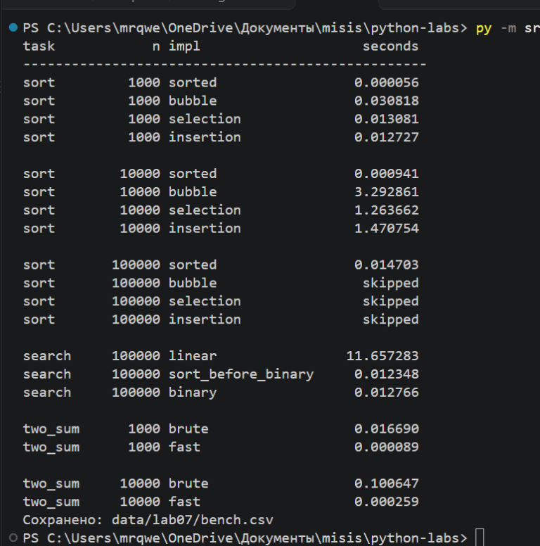

# Лабораторная работа № 7

## Задание A — поиск

[search.py](search.py)

### linear_search

- Поиск реализован перебором элементов по индексам.
- Возвращается первое вхождение, при отсутствии элемента — `-1`.

### binary_search

- Поиск выполняется в отсортированном списке между границами `lo` и `hi`.
- После сравнения с серединой граница сдвигается на `mid + 1` или `mid - 1`.
- При повторах возвращается любое вхождение, при отсутствии — `-1`.

### two_sum_brute

- Два вложенных цикла перебирают пары; второй индекс начинается с `i + 1`.
- Возвращается пара индексов с нужной суммой либо `None`.

### two_sum_fast

- Словарь `seen` хранит значения просмотренных элементов и их индексы.
- Дополнение `target - x` проверяется до записи текущего элемента.

## Задание B — сортировки

[sorting.py](sorting.py)

Все три сортировки работают с копией списка и сохраняют исходный.
Готовые `sorted`, `.sort()`, `min` и `max` внутри не используются.

### bubble_sort

- Соседние элементы меняются местами, если стоят не по порядку.
- После прохода правая граница уменьшается; флаг `swapped` позволяет выйти без лишних проходов.

### selection_sort

- Во вложенном цикле находится индекс минимального элемента оставшейся части.
- После поиска выполняется обмен с элементом на текущей позиции.

### insertion_sort

- Очередной элемент сохраняется в `value`, большие элементы слева сдвигаются вправо.
- После сдвигов значение записывается в `nums[j + 1]`.

## Задание C — проверка

[check.py](check.py)

- Каждая сортировка сравнивается с `sorted` на 100 случайных списках.
- Длины списков — от 0 до 50, значения — от −100 до 100.
- Отдельно проверяются сохранность исходного списка и возврат нового объекта.
- Линейный поиск сравнивается с `list.index`, бинарный проверяется на отсортированном списке.
- Проверяются крайние элементы, пустой список, один и два элемента.
- Для Two Sum выполняются 100 случайных прогонов; проверяются существование ответа, индексы и сумма.
- Сообщения `assert` содержат входные данные.

```powershell
py -m src.lab07.check
```

```text
OK: 798 проверок
```

## Задание D — замеры

[bench.py](bench.py)

- Время измеряется через `timeit`; данные создаются до начала замера.
- Для сравниваемых алгоритмов используются одинаковые списки, `random.seed(42)`.
- `sorted` и быстрый Two Sum запускаются по 100 раз с усреднением времени.
- Сортировки сравниваются на 1 000, 10 000 и 100 000 элементах.
- Свои сортировки на 100 000 не запускаются: `> 60` — условная отметка для пропущенных по размеру запусков, а не фактический замер.
- Поиск сравнивается на 10 000 запросах к списку из 100 000 элементов; сортировка перед бинарным поиском измеряется отдельно.
- Для Two Sum на 1 000 и 10 000 элементах цель равна сумме последних двух чисел, поэтому ответ существует.
- Таблица выводится в консоль и записывается в [bench.csv](../../data/lab07/bench.csv) через `write_csv` из ЛР4.

```powershell
py -m src.lab07.bench
```

```text
task            n impl                    seconds
--------------------------------------------------
sort         1000 sorted                 0.000056
sort         1000 bubble                 0.030818
...
Сохранено: data/lab07/bench.csv
```



## Выводы

При увеличении n с 1 000 до 10 000 пузырёк замедлился примерно в 107 раз:
0,030818 → 3,292861 с. Это согласуется с квадратичной сложностью O(n²),
при которой десятикратный рост размера даёт примерно стократный рост работы.
У `sorted` время выросло примерно в 16,8 и 15,6 раза на соседних размерах:
рост O(n log n) существенно медленнее квадратичного, а точные отношения зависят
от данных и условий измерения. На 100 000 элементов `sorted` затратил 0,014703 с;
свои квадратичные сортировки пропущены по ограничению размера.

Бинарный поиск требует отсортированного списка, иначе отбрасывание половины
диапазона некорректно. На 10 000 запросов линейный поиск затратил 11,657283 с,
бинарный — 0,012766 с, подготовка — 0,012348 с. С учётом сортировки бинарный
вариант занял 0,025114 с, выигрыш составил примерно 464 раза.
Сортировка окупается при многократных запросах; по средним временам этого замера —
примерно с 11-го запроса. В Two Sum словарь оказался быстрее перебора;
время зависит и от положения найденной пары. Проверка выполнила 798 проверок,
расхождений на итоговом прогоне нет. При подготовке исправлены возврат `-1`
в бинарном поиске и запись просмотренных чисел в словарь в быстром Two Sum.

## Задание со звёздочкой

- В пузырьке реализован ранний выход по флагу `swapped`: на отсортированном списке выполняется один проход.
